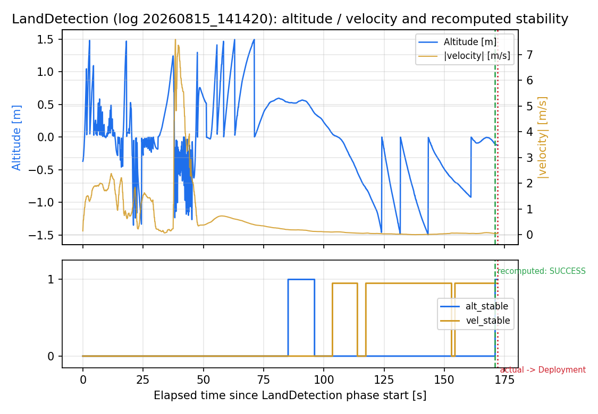

# 着地判定（LandDetection）

**東京大学船瀬五十里研究室 Halcyon**
作成日: 2026年08月15日

## 概要
本レポートは，2026-08-15 14:14:20に記録された飛行ログについて，Ejectフェーズ後の着地判定（`LandDetection`）フェーズの区間（`cmd_phase == "LandDetection"`）を抽出し，`LandDetection.cpp`と同一の判定ロジック（直近10秒間の高度・合成速度の変動幅が閾値以内かどうか）をログ上でオフライン再計算した上で，その再計算結果（いつ・どの結果で判定が確定したか）と，実機ログ上で実際に`cmd_phase`が次フェーズへ切り替わった時刻・遷移先を突き合わせ，一致しているかを機械的に確認する。

## 判定ロジック（`LandDetection.cpp`）

高度・合成速度（$\sqrt{v_N^2+v_E^2+v_D^2}$）それぞれについて，直近10秒間の
最大値と最小値の差が閾値以下なら「安定」とみなす。

- 高度の閾値：0.2 m
- 合成速度の閾値：0.05 m/s
- 安定判定に必要な監視時間：10 s
- タイムアウト：300 s

高度・速度が両方安定した瞬間に即 `SUCCESS` が確定する。タイムアウトまでに両方が安定
しなかった場合は，タイムアウト時点でどちらか片方だけ安定していれば `FALLBACK_*`となり次のフェーズ（Deployment phase）に遷移し，
どちらも安定していなければ `FATAL_FAILURE` となる。

```cpp
bool LandDetection::is_stable(const std::vector<LogData>& history, float threshold,
                                      std::chrono::steady_clock::time_point now) {
    if (history.empty()) return false;
    double total_elapsed = std::chrono::duration_cast<std::chrono::seconds>(
        now - history.front().timestamp).count();
    if (total_elapsed < MONITOR_DURATION_S - 0.5) return false;
    auto [min_it, max_it] = std::minmax_element(history.begin(), history.end(),
        [](const LogData& a, const LogData& b) { return a.value < b.value; });
    return (max_it->value - min_it->value) <= threshold;
}
```
（抜粋、`LandDetection.cpp`）

## 解析手法

上記のロジックを，記録済みログ（10Hz）に対してPythonでtime-based rolling window
（`pandas.Series.rolling("10s")`）として再現し，各時刻での`alt_stable`/
`vel_stable`を再計算した（`recompute_stability()`）。両方が最初にTrueになった瞬間を
`SUCCESS`，そうならないままタイムアウト秒に達した場合は実機の使用と同様にその時点の状態からフォール
バック種別を決定する。

この再計算結果を，同じログ内で実際に`cmd_phase`が`LandDetection`から抜けた時刻・遷移先フェーズと突き合わせる。

## 結果
LandDetectionフェーズは1714行（約172.1s）記録されている。オフライン再計算の結果，判定は**`SUCCESS`（通常着地）**として171.05s後に確定した。実機のログ上では172.16s後に`cmd_phase`が`LandDetection`から`Deployment`へ切り替わっており，再計算結果と実機ログ上の遷移先が一致している。



*高度・合成速度（上段）と，安定フラグ（下段）。緑破線＝再計算した判定確定時刻，赤点線＝実機ログ上の実際のフェーズ遷移時刻。*

## まとめ、懸念点
再計算した判定結果と実機ログ上の実際のフェーズ遷移は一致しており，`LandDetection`の判定ロジックが設計通り実機で動作していたことがこの飛行から確認できる。
ただし, 懸念点も存在する。例えば, 地面への着地後は機体が静止していることが動画から確認済みだが, フライトコントローラーからダウンリンクされた気圧計基準の高度と合成速度には図のようにブレつきがみられた。実際, そのぶれつきの把握が曖昧であったために今回の着地判定には2分以上もの長い時間がかかってしまた。そのため, 判定の閾値は試験を繰り返すことによって慎重に設定する必要があると痛感した。
また、着地判定をしてから次のフェーズに移るアルゴリズムは成立していることが確かめられたが、着地判定フェーズ自体は放出判定の誤りからキャリア内部で開始しており、その時間帯でのフライトコントローラーで認識された高度は実地高度と比較して明らかに異なり、フライトコントローラーで認識した高度は実地高度と近いものになっている。もし仮にキャリア内部に機体が収納されている状態で着地判定が認識されてしまったらキャリア内部で機体が起立・展開するため非常に危険である。そのため、高度取得の方法に関しては現在の気圧計を用いる方法から再考の余地がある。