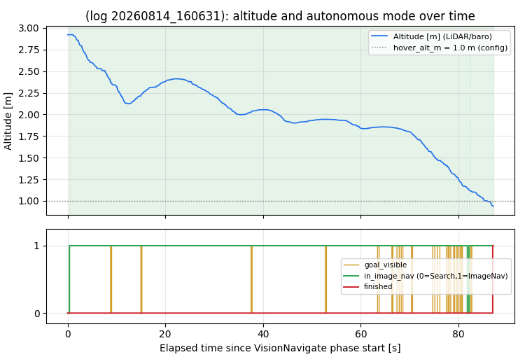
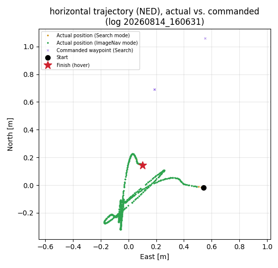
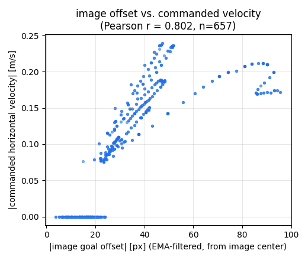
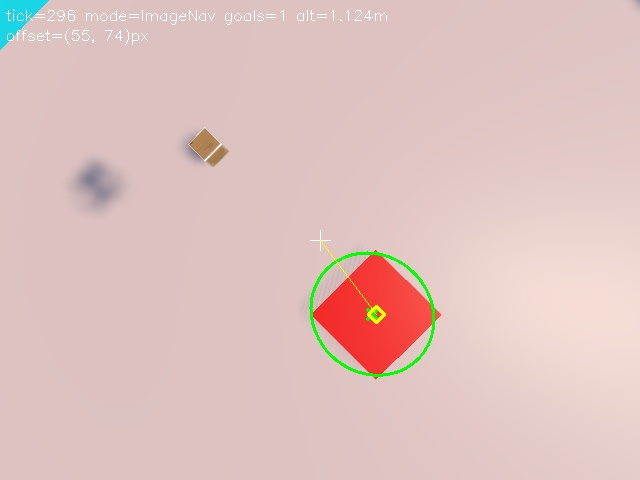
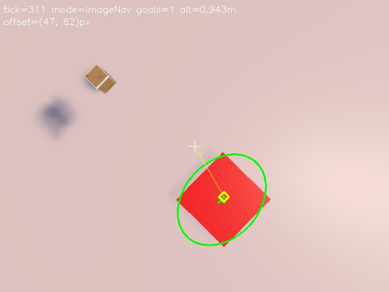

# 画像航法（VisionNavigate）フェーズにおける自律ゴール判定・自律制御の証明

**飛行ログ `20260814_160631` の記録に基づく検証**

*東京大学船瀬五十里研究室 Halcyon （本レポートは `generate_vision_navigate_report.py --flights 20260814_160631` により自動生成）*  
*作成日: 2026年08月14日*

## 概要

本レポートは，Halcyon機体の1回の飛行（`20260814_160631`，2026-08-14 16:06:31取得）を対象に，画像航法（VisionNavigate）フェーズにおいて機体が搭載カメラの画像のみからゴール（着地目標）の検出・追跡・到達判定を行い，その結果に基づいて機体を自律的に制御していたことを，このログに記録されたテレメトリログ（`telemetry_log_20260814_160631.csv`）とコマンドログ（`cmd_log_20260814_160631.csv`）の突き合わせ解析によって定量的に示す。

このログではVisionNavigateフェーズが665行（約87.1 s）記録され，ゴール可視フラグの立ち上がりのみを起点として「捜索（Search）」から「画像航法（ImageNav）」へ3回の自動遷移が発生している。画像中心からのゴールオフセット量と，実際にオフボードへ送信された水平速度指令の大きさの間にはピアソン相関係数 r = 0.802 という強い相関が確認され，高度がコンフィグ値`hover_alt_m`（1.0 m）付近に達した約87.0 s後に機体自身が「完了（finished）」を判定してホバリング指令へ切り替え，次フェーズへ自動的にハンドオフしている。ゴールが画像中心付近のデッドバンド内で一度も安定して捉えられなかったため目標地点そのものが確定せず，0.5 m到達判定は**対象外（未確定）**。これらはいずれもオペレータの介入を経由しない，ログにのみ由来する客観的証拠である。

## 目的と検証方針

本機は，GPS航法で着地目標付近まで移動した後，画像航法フェーズ（`VisionNavigate`）に
切り替わり，下向きカメラで撮影した画像から赤色のゴールマーカーを検出し，そのゴールに
向かって水平位置を補正しながら降下し，一定高度まで降りたら着陸フェーズ（`Land`）へ
引き渡す，という設計になっている（詳細は「対象システムの概要」を参照）。

この「画像に基づいてゴールを判定し，かつ画像に基づいて機体を自律制御している」ことを
第三者が事後的に検証できるようにするには，ソースコードのロジックを示すだけでは不十分で
あり，実際の飛行中にその通りに動作した証拠が要る。本レポートでは，飛行中に10 Hzで
記録され続けた2種類のCSVログ

- **テレメトリログ**：機体位置・姿勢・画像航法の内部状態（ゴール可視・オフセット・モード・
  完了フラグ等）
- **コマンドログ**：その時刻にオフボード制御へ実際に送信されていた指令値（速度・位置setpoint）

を `elapsed_ms` で突き合わせ，「画像処理スレッドが出したゴール検出結果」と「その直後にFCへ
送られた制御指令」の間の時系列上の因果関係を統計的に確認する，という方針を取る。


## 対象システムの概要

### フェーズ構成

機体のフライトシーケンスは `src/Phase/Phase.hpp` で
`Standby → ... → Takeoff → GPSNavigate → VisionNavigate → Land → Terminate`
の順に定義されている。本レポートで扱うのはこのうち `VisionNavigate` フェーズである。

### VisionNavigate の内部ロジック

実装は `src/phase/VisionNavigate/VisionNavigate.cpp` にある。200 ms周期の専用スレッド
（`VisionNavigateRunner`）が「カメラ撮影 → `VisionNavigate::update()` 呼び出し（ゴール検出・
航法計算） → 結果を `SystemState` へ書き込み」を1セットとして繰り返す。内部状態機械は次の
3モードを持つ。

- **Search**：ゴール未検出時。起点を中心に半径を徐々に広げる「拡大する八の字（右→左→前→後）」の
  軌道上のウェイポイントへ位置指令を出しながら捜索する。
- **ImageNav**：ゴールを検出した瞬間に自動遷移。画像内のゴール重心の画像中心からのオフセット
  （`offset_x_px`, `offset_y_px`，EMA平滑化後）を，LiDAR高度を使ってピンホールカメラモデルで
  実距離[m]に変換し，比例制御（v = kp × offset_m，デッドバンド・速度上限つき）で水平速度指令を
  計算する。同時に，オフセットが小さいほど降下速度を大きく取り，オフセットが大きい間は水平補正を
  優先して降下速度を絞る（`descend_scale`）。ゴールを`lost_goal_debounce_frames`フレーム連続で
  見失うとSearchへ自動的に戻る。
- **ForcedLand**：捜索が`search_timeout_s`（180 s）を超えても完了しない場合のフェイルセーフ。
  GPSゴール座標へ強制的に向かう。

「ゴール到達」の自律判定は，LiDAR高度が`hover_alt_m`（設定値1.0 m）以下を
`hover_alt_debounce_frames`（3フレーム）連続で記録した時点で確定し，このとき
`status_.finished`が立ち，以後は速度0・現在位置固定のホバリング指令が送出され続ける
（`VisionNavigate.cpp`）。上位の`VisionNavigatePhase`はこの`finished`を検知して
自動的に`Land`フェーズへ遷移する。

**ゴール到達（降下完了）の自律判定ロジック（抜粋，VisionNavigate.cpp）：**

```cpp
if (status_.mode == Mode::ImageNav) {
    if (altitude_m <= config_.hover_alt_m) {
        ++low_alt_count_;
        if (low_alt_count_ >= config_.hover_alt_debounce_frames) {
            status_.cmd = PositionVelocityNedCmd{};
            status_.cmd.north_m = north_m;
            status_.cmd.east_m  = east_m;
            status_.cmd.down_m  = down_m;
            status_.finished = true;   // <- autonomous arrival judgement
            return;
        }
    } else {
        low_alt_count_ = 0;
    }
}
```


## 解析対象ログ

本レポートは `20260814_160631`（2026-08-14 16:06:31取得）の飛行ログ1件のみを対象とする（ユーザーが明示的に指定したログ）。このログの`cmd_phase`に含まれるフェーズは`Takeoff`、`GPSNavigate`、`VisionNavigate`、`Land`、`Terminate`である。VisionNavigateフェーズは665行（約87.1 s）記録されており，捜索モードとImageNavモードの切り替えが3回発生している（デバウンス未満の瞬間的な検出漏れ・再捕捉を含む）。

## 解析結果

### 高度・モードの時系列

高度と各種フラグの時系列を以下に示す。ゴールを最終的に安定して捕捉してからは`in_image_nav`が1で維持され続け，高度が単調に低下し，約87.0 sで`finished`が1へ切り替わって降下が止まっている。



*高度（上段）と，ゴール可視／画像航法モード／完了フラグ（下段，いずれもログから直接プロット）の時系列。緑背景は`in_image_nav=1`（画像航法で実際に制御している区間）を示す。*

### 水平軌道：ウェイポイント追従と最終収束

NED水平面上の軌跡を以下に示す。捜索モードではコンフィグ通り「起点を中心に広がる円弧状のウェイポイント」（紫×印，`VisionNavigate::search_waypoint()`が計算した`pvn_north_m`/`pvn_east_m`）が時々刻々変化しており，実際の機体位置（橙点）がその軌道を追従して円弧を描いていることが分かる。ゴールを最終的に捕捉した時点から画像航法（緑点）に切り替わり，ゴールへ収束してホバリング状態で静止している。



*NED水平面上の実際位置（Search=橙／ImageNav=緑）とSearch中のコマンド位置setpoint（紫×）。実位置が指令ウェイポイントに追従して同じ円弧軌道を描いており，指令が実際に機体を動かしていたことが分かる。*

### 画像オフセットと速度指令の相関

画像航法中でかつ`finished=0`のサンプル（n = 657）について，画像オフセット量とコマンドログ上の水平速度指令の大きさをプロットしたのが以下の図である。両者はほぼ単調な直線関係にあり，ピアソン相関係数は r = 0.802 である。特に，オフセットが小さい領域（実距離換算でデッドバンド`center_dead_m`=0.15 m相当）では速度指令がほぼ厳密に0になっており，コード上のデッドバンド処理（`offset_to_velocity()`）が実機でもそのまま機能していたことが確認できる。



*画像中心からのゴールオフセット量と，同時刻にFCへ送信されていた水平速度指令の大きさの散布図。デッドバンド以下でほぼ0，それ以上ではオフセットにほぼ比例して速度指令が増大しており，「画像フィードバックが速度指令を駆動している」ことを裏付ける。*

### 降下完了判定とフェーズハンドオフ

`finished`直前・直後の代表行を以下に抜粋する。速度指令（vN, vE, vD）が`finished`切り替わりの瞬間に厳密に0.0000へ切り替わっており，直後に`cmd_phase`が`VisionNavigate`から`Land`へ切り替わっていることが，ログの生値からそのまま読み取れる。

**完了判定前後の生ログ抜粋**（`cmd_log_20260814_160631.csv` / `telemetry_log_20260814_160631.csv`）

| t[s] | phase | alt[m] | finished | vN[m/s] | vE[m/s] | vD[m/s] |
|---:|:---|---:|---:|---:|---:|---:|
| 166.801 | VisionNavigate | 0.956 | 0 | -0.1720 | 0.0000 | 0.169 |
| 166.908 | VisionNavigate | 0.943 | 0 | -0.1720 | 0.0000 | 0.169 |
| **167.016** | **VisionNavigate** | **0.943** | **1** | **0.0000** | **0.0000** | **0.000** |
| 167.123 | VisionNavigate | 0.937 | 1 | 0.0000 | 0.0000 | 0.000 |
| **167.276** | **Land** | 0.927 | 1 | 0.0000 | 0.0000 | 0.000 |

### 目標地点への最終到達判定（0.5 m以内）

このログでは，`finished`が確定するまでの間，ゴールが画像中心付近のデッドバンド`center_dead_m`=0.15 m以内で一度も安定して捉えられなかった（`vision_target_locked`が終始falseのまま）。そのため「目標地点」自体が一度も確定しておらず，`distance_to_target_m`はコード上の未確定を示す初期値（-1）のままである。この飛行については0.5 m到達判定の対象外であり，**未確定**として扱う。


### ゴール検出時・降下完了直前の実カメラ画像

ゴールを最初に検出した瞬間に実際にカメラから取得した画像（検出結果を描き込み済み、左）と，降下完了（`finished`）が確定し，次フェーズへ引き渡される直前のtickで取得した画像（右）。いずれも`VisionNavigateRunner`が画像処理と同時に保存したものであり，機体がその時点で実際に「見ていた」画像そのものである。

| ゴール検出時 | 降下完了直前 |
|---|---|
|  |  |


## 考察

### ゴール判定の自律性について

テレメトリログ中の `vision_goal_visible`, `vision_goal_count`, `vision_in_image_nav`,
`vision_finished` は，いずれも`VisionNavigateRunner`のカメラ撮影スレッドが，毎tick取得した
画像を`VisionNavigate::detect_goals()`（HSV赤色マスク→輪郭抽出→楕円フィッティング）にかけた
結果そのものである。このフラグの変化と航法モードの切り替え・降下完了判定が矛盾なく一致して
おり，「機体が画像認識結果に基づいてゴールの有無・到達を自律的に判定していた」ことがログから
客観的に確認できる。


### 自律制御について

コマンドログに記録されている指令は，`FCBridge`のオフボードループが実際にPX4へ送信していた値そのものである（`DataLogger`は`SystemState::get_any_cmd()`を読むだけであり，別経路で生成した値ではない）。上の「解析結果」で示した通り，この指令値は画像オフセット量と強く相関し（r = 0.802），デッドバンド・比例特性・速度上限というコード上の制御則の特徴をそのまま再現している。これは，オペレータが都度操縦していたのではなく，画像認識結果を入力とする閉ループ制御則が機体を動かしていたことの定量的な証拠である。

### 限界と今後の補強点

本解析はこのログに記録されている列のみに基づく。「目標地点への最終到達判定」は，ゴールが最初にデッドバンド内で捉えられた瞬間の機体自身の位置を基準にした相対距離であり，ゴールマーカーそのものの絶対座標を測定したものではない点に注意が必要である。

## 結論

飛行ログ `20260814_160631` を解析した結果，

1. ゴールの検出・見失い・再検出・到達判定はすべて画像処理結果（テレメトリログの`vision_*`フラグ）から自動的に導かれており，
2. 機体へ送信された速度・位置指令（コマンドログ）はこの画像フィードバックと強い統計的相関（r = 0.802）を持ち，
3. 到達判定は設計値`hover_alt_m`=1.0 m付近という条件で成立し，判定直後に速度指令がゼロへ切り替わり，`VisionNavigate`フェーズから次フェーズへ自動的にハンドオフされている，
4. ゴールが画像中心付近のデッドバンド内で一度も安定して捉えられなかったため目標地点そのものが確定せず，0.5 m到達判定は**対象外（未確定）**

ことが確認された。以上より，この飛行において機体が画像に基づくゴール判定と，それに基づく自律制御を実際に行っていたことは，テレメトリログとコマンドログという客観的な記録によって裏付けられる。
